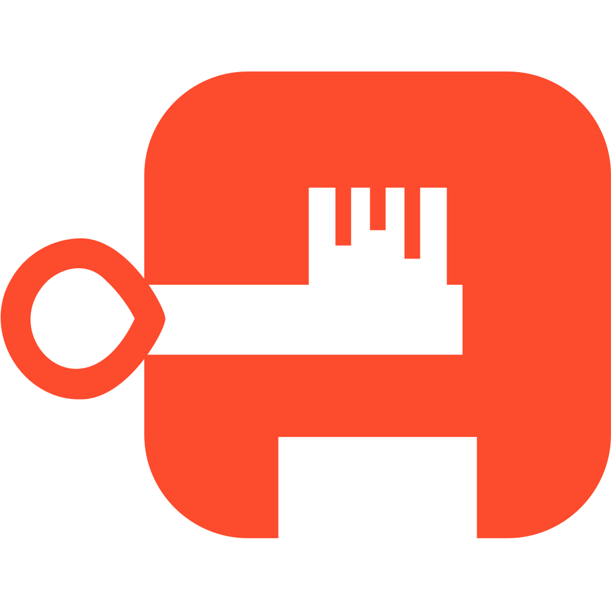
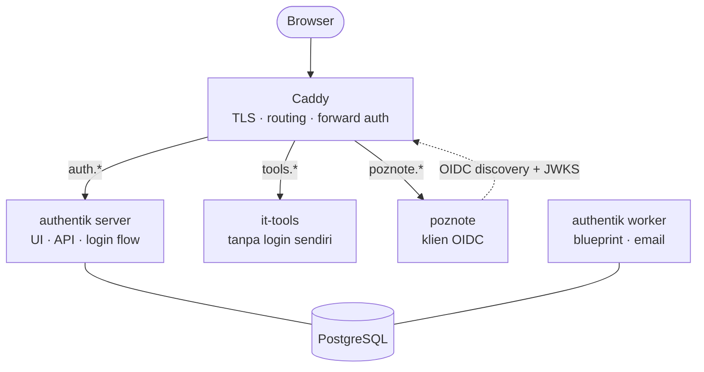
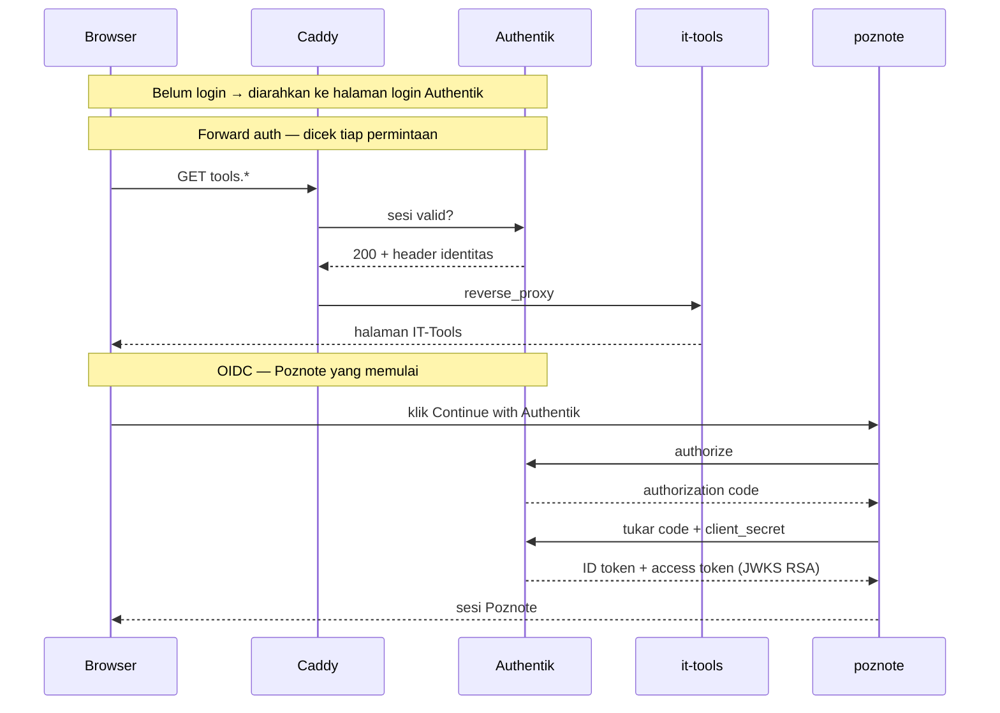

<h1 align="center">authentik<br/></h1>

<p align="center">Self-hosted SSO: Authentik + Caddy + forward auth pada IT-Tools dan OIDC pada Poznote</p>

[Sekilas Tentang](#sekilas-tentang) | [Instalasi](#instalasi) | [Setelah Instalasi](#setelah-instalasi) | [Konfigurasi](#konfigurasi) | [Otomatisasi](#otomatisasi) | [Penggunaan Lanjutan](#penggunaan-lanjutan) | [Pembahasan](#pembahasan) | [Referensi](#referensi)
:---:|:---:|:---:|:---:|:---:|:---:|:---:|:---:

<!-- TODO: isi nama kelompok dan anggota -->


# Sekilas Tentang
[`^ kembali ke atas ^`](#)

**Authentik** adalah *identity provider* (IdP) *open source* yang menyediakan *single sign-on* (SSO), *multi-factor authentication* (MFA), dan manajemen pengguna terpusat. Pengguna cukup login satu kali untuk mengakses banyak aplikasi; administrator mengatur hak akses dari satu tempat. *Tech stack*: Python/Django + PostgreSQL.

<!-- TODO: sejarah singkat, pengembang, lisensi -->
<!-- TODO: tech stack (backend Python/Django, database PostgreSQL) - cek dokumentasi resmi -->

### Mengapa Penting
- Satu login untuk banyak aplikasi (SSO)
- Kontrol akses terpusat berdasarkan pengguna, grup, dan kebijakan
- MFA dapat diterapkan pada aplikasi yang tidak punya MFA sendiri
- Semua aktivitas login tercatat pada *audit log*

### Arsitektur

Authentik berjalan sebagai beberapa kontainer:

- **server**: antarmuka web, API, *login flow* (juga menampung *embedded outpost* untuk *forward auth*)
- **worker**: tugas latar belakang (email, blueprint, pembersihan data)
- **PostgreSQL**: pengguna, grup, *flow*, kebijakan, dan *audit log*
- **Outpost** (opsional): kontainer *proxy* untuk melindungi aplikasi lain

Redis tidak lagi dipakai sejak rilis 2025.10; `docker-compose.yml` resmi saat ini hanya memuat `postgresql`, `server`, dan `worker`.



Yang perlu diperhatikan:

- **Hanya Caddy** yang menerima lalu lintas luar. Port `9000`/`9443`/`8040` terikat *loopback*; IT-Tools tidak punya port host sama sekali.
- **Forward auth** (IT-Tools): Caddy bertanya ke Authentik di setiap permintaan, lalu meneruskan beserta header identitas. Aplikasinya tidak tahu apa-apa soal autentikasi. Pemeriksaan sesi itu dilayani *embedded outpost*, yang berjalan di dalam kontainer `server` — karena itu diagram tidak menggambarnya sebagai kotak terpisah. Outpost kontainer berdiri sendiri hanya dipakai untuk aplikasi *proxy/LDAP* di luar stack ini.
- **OIDC** (Poznote) bekerja sebaliknya: Authentik tidak meneruskan permintaan ke Poznote. Poznote menghubungi Authentik lewat **URL publik** `auth.*` untuk *discovery* dan JWKS. Jangan pakai issuer container-name/HTTP internal.
- **worker** yang menerapkan `blueprint.yaml` dan mengirim email, jadi perubahan konfigurasi terlihat walau hanya `server` yang dibuka di browser.

### Komponen Pendukung pada Demo

Authentik paling mudah dipahami jika ada aplikasi yang dilindunginya. Demo ini menambahkan tiga komponen ke *stack* yang sama:

| Komponen | Peran | Login |
|---|---|---|
| **Caddy** | *Reverse proxy*: satu pintu HTTPS untuk tiga nama host, penjaga pintu aplikasi tanpa login | — |
| **IT-Tools** | Kumpulan alat developer berbasis web (base64, hash, UUID); statis, ringan, **tanpa sistem login** | *Forward auth* |
| **Poznote** | Aplikasi catatan modern; tiap pengguna punya workspace sendiri | OIDC |

Caddy mengambil sertifikat ACME otomatis pada Opsi A, atau menerima HTTP internal dari `cloudflared` pada Opsi B (`Caddyfile.tunnel`). Caddy **tidak wajib** untuk Authentik, tetapi diperlukan agar demo HTTPS dan *forward auth* berjalan.

### Forward auth vs OIDC

| | Forward auth | OIDC (OpenID Connect) |
|---|---|---|
| Analogi | Satpam di pintu masuk | Tombol "Login dengan Google" |
| Aplikasi harus mendukung? | Tidak | Ya |
| Akun per pengguna di aplikasi | Tidak (hanya header identitas) | Ya |
| Yang bekerja | Caddy + Authentik | Aplikasi + Authentik |
| Contoh pada demo | IT-Tools | Poznote |



Perbedaan praktis:

- *Forward auth*: setiap permintaan IT-Tools dicek ke Authentik lebih dulu; IT-Tools tidak menyimpan status login.
- OIDC: sesi Poznote terpisah dari sesi Authentik, masing-masing punya *logout* sendiri — uji keduanya, jangan berasumsi satu *logout* mengakhiri keduanya.
- Tombol "Continue with Authentik" hanya muncul bila toggle OIDC aktif, *Issuer* terisi, dan `POZNOTE_OIDC_CLIENT_ID` terisi di environment container. Ketiga syarat itu diperiksa Poznote, bukan konektivitas jaringan.


# Instalasi
[`^ kembali ke atas ^`](#)

Alur: prasyarat → Docker/Podman → clone repo → `.env` → backend privat → bootstrap admin → buka ingress (Opsi A atau B) → integrasi aplikasi.

### Kebutuhan Sistem

- Server: VPS Debian 12+ / Ubuntu 22.04+ dengan **IP publik** (Opsi A), ATAU komputer lokal Debian/Ubuntu (Opsi B)
- RAM minimal 2 GB (disarankan 3–4 GB bila demo Caddy + IT-Tools + Poznote ikut jalan), CPU 2 core, disk 20 GB
- Satu domain dengan DNS yang Anda kelola; tiga subdomain (Authentik, IT-Tools, Poznote)

| Runtime | Prasyarat | Direktori | Compose |
|---|---|---|---|
| **Docker** (default) | `sudo`, daemon rootful, socket `/var/run/docker.sock` di-mount ke worker; Ubuntu 22.04 didukung | `/opt/authentik` | `sudo docker compose …` |
| **Podman rootless** | Login normal tanpa `sudo`; Debian ≥ 12 / Ubuntu ≥ 24.04, Podman ≥ 4.3, cgroup v2, subordinate UID/GID ≥ 65536, user bus + `podman.socket` milik sendiri, lingering aktif | `$HOME/.local/share/authentik` (0700) | `$HOME/.local/share/authentik/podman-compose.sh` |

<!-- TODO: screenshot setiap langkah, seperti pada contoh laporan -->

UID 0 di dalam worker/kontainer adalah hasil pemetaan namespace, bukan root host. Semua gerbang bootstrap dua admin, URL publik embedded-outpost, callback strict Poznote, RSA signing key, issuer/JWKS publik, dan redirect edge Cloudflare sama pada kedua runtime.

> **Konvensi penulisan:** contoh perintah di bawah memakai jalur Docker (`sudo docker compose`, `/opt/authentik`). Pengguna Podman mengganti prefix dengan `$HOME/.local/share/authentik/podman-compose.sh` **tanpa `sudo`** dan direktori dengan direktori aplikasi user. Catatan khusus Podman yang tidak sekadar pergantian prefix ditandai eksplisit.

### Langkah Bersama: Instal Docker (default)

1. Login ke server/komputer.
    ```
    $ ssh user@<ip-server>
    ```

2. Instal Docker dari repositori resmi (bukan `docker.io` bawaan distro). **Bila sebelumnya pernah memasang Docker**, hapus dulu paket bawaan yang bentrok:
    ```
    $ sudo apt remove $(dpkg --get-selections docker.io docker-compose docker-compose-v2 docker-doc docker-buildx podman-docker containerd runc | cut -f1)
    ```
    Daftar mengikuti instruksi resmi Docker; `dpkg --get-selections` hanya menyertakan paket yang benar-benar terpasang (`apt` boleh melaporkan sebagian paket tidak ada — aman diabaikan). Perintah ini **hanya menghapus paket, tidak menghapus data**: kontainer, image, dan volume lama tetap di `/var/lib/docker`.
    ```
    $ sudo apt-get update
    $ sudo apt-get install -y ca-certificates curl gnupg
    $ sudo install -m 0755 -d /etc/apt/keyrings
    $ sudo curl -fsSL https://download.docker.com/linux/$(. /etc/os-release && echo "$ID")/gpg -o /etc/apt/keyrings/docker.asc
    $ sudo chmod a+r /etc/apt/keyrings/docker.asc
    $ . /etc/os-release
    $ echo "deb [arch=$(dpkg --print-architecture) signed-by=/etc/apt/keyrings/docker.asc] https://download.docker.com/linux/${ID} ${UBUNTU_CODENAME:-$VERSION_CODENAME} stable" | sudo tee /etc/apt/sources.list.d/docker.list
    $ sudo apt-get update
    $ sudo apt-get install -y docker-ce docker-ce-cli containerd.io docker-buildx-plugin docker-compose-plugin
    ```
    `$ID` menyesuaikan repo Docker (`debian`/`ubuntu`); `${UBUNTU_CODENAME:-$VERSION_CODENAME}` memilih suite yang benar di kedua distro. Ubuntu yang didukung: 22.04 (jammy), 24.04 (noble), 26.04 (resolute).

3. Unduh `docker-compose.yml` resmi Authentik.
    ```
    $ sudo mkdir -p /opt/authentik
    $ sudo curl -fsSL -o /opt/authentik/docker-compose.yml https://docs.goauthentik.io/compose.yml
    ```

4. Klon repo ini. Semua langkah berikutnya memakai file dari repo ini (Compose override, overlay, Caddyfile), jadi file harus ada di server:
    ```
    $ sudo apt-get update && sudo apt-get install -y git
    $ cd ~ && git clone https://github.com/nandazahran/authentik.git
    $ cd ~/authentik
    $ ls
    ```
    `git clone` menjaga bit *executable* `setup.sh`, sehingga tidak muncul `Permission denied` seperti saat file diunduh satu per satu. Sudah pernah klon? Jangan klon ulang — cukup `cd ~/authentik && git pull --ff-only`. Isi folder kerja: `README.md`, `setup.sh`, `Caddyfile`/`Caddyfile.tunnel`, `docker-compose.*.yml`, `blueprint.yaml`.

#### Alternatif: Podman rootless (tanpa `sudo` deployment)

Pengguna Podman **lewati seluruh langkah Docker di atas** (jangan tambah repo Docker, jangan hapus paket bawaan distro) dan **jangan pernah** menjalankan deployment/Compose/Podman/`systemctl --user` di bawah `sudo`. `sudo` hanya untuk prasyarat host (paket, lingering, sysctl VPS, hardening).

1. Login langsung sebagai user deployment (SSH normal, bukan `sudo -i`/`su`). Verifikasi sesi user, home lokal, dan subordinate ID:
    ```
    $ ssh user@<ip-server>
    $ echo $XDG_RUNTIME_DIR            # wajib /run/user/<uid> milik sendiri
    $ systemctl --user show-environment > /dev/null && echo USER-BUS-OK
    $ grep -E "^(user|$(id -u)):" /etc/subuid /etc/subgid
    ```
    Setiap file wajib punya minimal satu range kontigu ≥ 65536 ID untuk UID Anda, tanpa tumpang tindih dengan akun lain. Range hilang/tidak valid/tumpang tindih = minta administrator mengalokasikan range unik; jangan menempel contoh range tetap, jangan ubah mapping akun aktif, jangan `podman system migrate`/`reset`. Setelah akun disiapkan, logout lalu login SSH langsung lagi.

2. Instal paket distro sebagai administrator (satu-satunya `sudo` di sini):
    ```
    $ sudo apt-get update
    $ sudo apt-get install -y podman ca-certificates curl openssl uidmap slirp4netns fuse-overlayfs dbus-user-session netavark aardvark-dns
    ```
    Bila kandidat Ubuntu tidak ditemukan, aktifkan `universe` (`sudo add-apt-repository universe`). Debian 12 dengan backend `cni` warisan butuh tambahan `containernetworking-plugins golang-github-containernetworking-plugin-dnsname`. Jangan instal `podman-docker`, paket Compose distro, atau repo engine pihak ketiga. Verifikasi sebagai user deployment:
    ```
    $ podman --version                                     # >= 4.3.0
    $ podman unshare true
    $ podman info --format '{{.Host.Security.Rootless}}'   # true
    $ podman info --format '{{.Host.CgroupVersion}}'       # v2
    $ podman info --format '{{.Host.NetworkBackend}}'      # netavark (cni hanya warisan Debian 12)
    ```
    Bila `podman unshare`/`podman info` gagal permission denied dan audit kernel menunjukkan denial AppArmor `userns_create` (Ubuntu 24.04), berhenti dan laporkan denial persisnya ke administrator: butuh kebijakan AppArmor sempit dari paket Podman/AppArmor distro. Jangan menonaktifkan AppArmor/seccomp/userns global (`kernel.apparmor_restrict_unprivileged_userns=0` dilarang).

3. Aktifkan user socket + lingering (socket rootful/system tidak dibutuhkan):
    ```
    $ systemctl --user enable --now podman.socket
    $ sudo loginctl enable-linger "$(id -un)"
    $ loginctl show-user "$(id -un)" -p Linger --value   # yes
    $ curl --fail --silent --show-error --unix-socket "$XDG_RUNTIME_DIR/podman/podman.sock" http://localhost/_ping   # OK
    ```
    Socket user memberi wewenang manajemen kontainer user tersebut — biarkan Unix-only dan berizin privat, jangan diekspos TCP.

4. Instal provider Compose milik user (tanpa `sudo`). `setup.sh --runtime podman` melakukannya otomatis; manual:
    ```
    $ mkdir -p ~/.local/lib/authentik
    $ curl -fsSL -o ~/.local/lib/authentik/.docker-compose.tmp https://github.com/docker/compose/releases/download/v5.6.0/docker-compose-linux-$(uname -m | sed 's/arm64/aarch64/')
    $ echo "<sha256-resmi>  $HOME/.local/lib/authentik/.docker-compose.tmp" | sha256sum -c -
    $ chmod 755 ~/.local/lib/authentik/.docker-compose.tmp && mv ~/.local/lib/authentik/.docker-compose.tmp ~/.local/lib/authentik/docker-compose
    ```
    SHA-256 resmi v5.6.0: `x86_64` = `40343e21...eb63e76a` (lengkap di `setup.sh`), `aarch64` = `733ec767...58078ea2`. Arsitektur lain gagal eksplisit. Hanya byte terverifikasi yang dipasang; binary lain di path terisolasi ini adalah konflik — periksa manual, jangan timpa diam-diam.

5. Klon repo dan siapkan direktori aplikasi milik user:
    ```
    $ sudo apt-get update && sudo apt-get install -y git   # satu-satunya sudo di langkah ini
    $ cd ~ && git clone https://github.com/nandazahran/authentik.git
    $ mkdir -p -m 0700 ~/.local/share/authentik && cd ~/.local/share/authentik
    $ cp -p ~/authentik/docker-compose.override.yml ~/authentik/docker-compose.vps.yml ~/authentik/Caddyfile .
    $ cp -p ~/authentik/docker-compose.podman.yml ~/authentik/podman-compose.sh ~/authentik/authentik-podman.service .
    $ chmod +x podman-compose.sh
    $ curl -fsSL -o docker-compose.yml https://docs.goauthentik.io/compose.yml   # file upstream tak berubah
    $ printf 'podman-rootless' > .container-runtime && chmod 600 .container-runtime
    ```
    Jangan mengadopsi storage user lain/rootful/Docker sebagai migrasi: target eksplisit `podman-rootless` hanya diterima untuk UID pemiliknya; marker `docker`/rootful/tak dikenal, atau config tanpa marker, ditolak. Secret dibuat hanya saat instalasi fresh; `.env` dan `cloudflared.env` milik user mode `600`. Urutan file di `.env` (manual, tanpa blueprint):
    ```
    COMPOSE_FILE=docker-compose.yml:docker-compose.override.yml:docker-compose.vps.yml:docker-compose.podman.yml
    ```
    Ganti `docker-compose.vps.yml` dengan `docker-compose.tunnel.yml` untuk Opsi B. Instalasi otomatis menambahkan `:docker-compose.blueprint.yml` **paling akhir** agar mount blueprint worker selamat dari penggantian volume Podman. Daftar yang mencampur overlay Podman dan Docker ditolak.

### Siapkan `.env`

Nama host contoh (`auth.example.com`, `tools.example.com`, `poznote.example.com`) hanyalah contoh, bukan nilai harfiah. Gunakan tiga FQDN berbeda di domain Anda dan pakai nilainya secara konsisten di `.env`, DNS, dan pengaturan provider. Bila sebuah label sudah dipakai record lain, pilih label lain (mis. tambah `-demo`).

1. Salin konfigurasi ke `/opt/authentik` — Opsi A memakai `Caddyfile`, Opsi B memakai `Caddyfile.tunnel`:
    ```
    $ cd ~/authentik
    $ sudo cp docker-compose.override.yml docker-compose.vps.yml Caddyfile /opt/authentik/          # Opsi A
    $ sudo cp docker-compose.override.yml docker-compose.tunnel.yml Caddyfile.tunnel /opt/authentik/ # Opsi B
    ```

2. Buat `.env` dan isi:
    ```
    $ cd /opt/authentik
    $ echo "PG_PASS=$(openssl rand -base64 36 | tr -d '\n')" | sudo tee .env
    $ echo "AUTHENTIK_SECRET_KEY=$(openssl rand -base64 60 | tr -d '\n')" | sudo tee -a .env
    $ sudo nano .env
    ```
    Tambahkan baris berikut (Opsi A):
    ```
    COMPOSE_FILE=docker-compose.yml:docker-compose.override.yml:docker-compose.vps.yml
    AUTH_PUBLIC_HOST=auth.example.com
    TOOLS_PUBLIC_HOST=tools.example.com
    POZNOTE_PUBLIC_HOST=poznote.example.com
    AUTHENTIK_TAG=2026.8.4
    ```
    Opsi B: ganti `docker-compose.vps.yml` dengan `docker-compose.tunnel.yml`. `COMPOSE_FILE` membuat overlay selalu aktif untuk setiap perintah `docker compose` dari direktori ini; jangan simpan `COMPOSE_PROFILES=tunnel` (konektor sengaja tidak ikut `up -d` biasa).

    `AUTHENTIK_TAG` **wajib**: tanpa baris ini tag mengikuti default file `compose.yml` resmi yang ikut berubah tiap rilis, sehingga `docker compose pull` bisa naik versi tanpa disadari. Naik versi hanya dengan sengaja — lihat [Menaikkan versi Authentik](#menaikkan-versi-authentik-peningkatan-tag-gambar). Kredensial OIDC Poznote (`POZNOTE_OIDC_CLIENT_ID`/`SECRET`) diisi setelah provider OAuth2 dibuat di Authentik ([Integrasi Aplikasi](#integrasi-aplikasi-jalur-manual-tanpa-blueprint) bagian Poznote).

3. Kunci izin file secret:
    ```
    $ sudo chmod 600 .env
    ```
    **Opsi B saja** — buat file token konektor (masih kosong):
    ```
    $ sudo touch cloudflared.env && sudo chmod 600 cloudflared.env
    ```

### Jalankan backend privat

Caddy/konektor belum dijalankan, jadi belum ada ingress publik sama sekali.

```
$ sudo docker compose config --quiet
$ sudo docker compose pull
$ sudo docker compose up -d server worker poznote it-tools
```

Jangan pernah mencetak `docker compose config` tanpa `--quiet` di mesin berisi secret asli.

> **Penting — patok tag dan cadangkan sebelum `pull`.** Jalur manual ini tidak dijaga `setup.sh`, jadi kedua penjaganya dipasang sendiri: (1) `.env` memuat tag yang dipatok, (2) instalasi yang sudah pernah jalan dicadangkan dulu — `sudo docker compose exec -T postgresql pg_dump -U authentik -Fc authentik > authentik-manual-$(date +%Y%m%d).dump`. Re-run `pull` pada instalasi berisi data berarti naik versi: migrasi Django yang gagal di tengah meninggalkan basis data setengah jalan dan Authentik masuk *crash-loop* (`InconsistentMigrationHistory`) yang tetap terlihat "Up". Pada instalasi baru kedua perintah di atas aman.

Konfirmasi Authentik sehat, lalu pastikan server tidak *crash-loop* (dua kali berjarak ~45 detik, angka harus sama):

```
$ curl -fsS http://127.0.0.1:9000/-/health/live/
$ sudo docker inspect authentik-server-1 --format '{{.RestartCount}}'
```

Kalau `RestartCount` naik, hentikan dan periksa `docker compose logs --tail=100 server | grep -i inconsistent` (pemulihan: [Menaikkan versi Authentik](#menaikkan-versi-authentik-peningkatan-tag-gambar)).

### Bootstrap admin lewat SSH port-forward

Dari komputer yang menjalankan browser (halaman ini hanya lewat SSH, tidak dipublikasikan):

```
$ ssh -N -L 9000:127.0.0.1:9000 -L 8040:127.0.0.1:8040 user@<ip-server>
```

- Buka `http://localhost:9000/if/flow/initial-setup/` dan buat kata sandi admin Authentik yang kuat.
- Buka `http://localhost:8040`, login Poznote sebagai `admin_change_me` / `admin`, ganti **username dan password**, lalu **logout dan pastikan kredensial lama ditolak**.

**Jangan buka ingress publik sebelum kedua akun selesai diganti dan kredensial bawaan Poznote terbukti tidak bisa login lagi.** Panduan MFA ada di [Setelah Instalasi](#setelah-instalasi).

### Buka ingress: pilih satu opsi

| | Opsi A: VPS | Opsi B: komputer lokal |
|---|---|---|
| Prasyarat | IP publik, inbound 80/443 | Domain di akun Cloudflare, tanpa IP publik |
| TLS | Caddy + ACME (Let's Encrypt) | Dihentikan di edge Cloudflare |
| Ingress | Caddy mempublikasikan 80/443 | `cloudflared` koneksi *outbound*; Caddy hanya di jaringan internal |
| Langkah kunci | DNS `A`/`AAAA`, firewall | Tunnel + tiga *public hostname* + redirect HTTPS |

#### Opsi A: VPS dengan IP Publik (Caddy langsung + ACME)

1. Buat tiga DNS record `A`/`AAAA` ke IP publik VPS, satu per nama host. Tunggu penyebaran (`dig +short <host>`).

2. Buka ingress di firewall VPS: izinkan inbound 80 dan 443 (Caddy + ACME) serta SSH dari jaringan administrasi. **Jangan** buka inbound 9000/9443/8040 — binding Docker sudah di-*loopback*.

3. Jalankan stack penuh. Caddy baru mulai sekarang, setelah kredensial default tidak berlaku:
    ```
    $ sudo docker compose up -d
    ```
    Sertifikat ACME diterbitkan saat permintaan pertama; bila gagal, cek `sudo docker compose logs caddy`. Verifikasi kontainer: `sudo docker compose ps`.

    > **Podman rootless (Opsi A manual):** urutan validasi sama, tapi siapkan storage rootless dulu: buat `data`/`certs`/`custom-templates` (0755, tolak symlink/non-direktori), lalu untuk tiap direktori `data`/`certs` yang baru dibuat attempt ini jalankan `podman unshare chown 1000:1000 <path-absolut>` (jangan inisialisasi path lama, jangan `chmod 777`/chown host-root rekursif). Verifikasi: `podman-compose.sh run --rm --no-deps --user authentik --entrypoint /bin/sh worker -ec 'test -w /data && test -r /templates && test -w /certs'`. Rootless Caddy butuh `net.ipv4.ip_unprivileged_port_start=80`: bila nilai efektif sudah ≤ 80, kebijakan existing cukup. Bila > 80: tulis `/etc/sysctl.d/90-authentik-rootless-ports.conf` berisi persis `net.ipv4.ip_unprivileged_port_start = 80` (root-owned 0644), terapkan hanya key ini via `sudo sysctl -w net.ipv4.ip_unprivileged_port_start=80`; file existing identik dipakai ulang, isi berbeda = konflik, berhenti jangan timpa. Mapping Caddy 80/443 tetap dipertahankan agar konfigurasi ACME/redirect existing tetap bisa dipakai.

#### Opsi B: Komputer Lokal via Cloudflare Tunnel

Untuk komputer lokal **tanpa IP publik dan tanpa port forwarding di router**: `cloudflared` melakukan koneksi *outbound* ke Cloudflare, HTTPS dihentikan di edge, Caddy dihubungi lewat jaringan internal Compose.

1. Di dashboard Cloudflare (Zero Trust > Networks > Tunnels) buat satu tunnel *remotely managed* bernama `authentik-demo`. Simpan token sebagai `TUNNEL_TOKEN=<token-asli>` di `/opt/authentik/cloudflared.env` **menggunakan editor**, bukan argumen command-line atau assignment shell yang masuk riwayat:
    ```
    $ sudo nano /opt/authentik/cloudflared.env
    ```
    Buat tiga *public hostname*, masing-masing satu nama host pilihan Anda, *Service type* **HTTP** dengan URL `caddy:80`, tanpa path. Biarkan *HTTP Host Header override* kosong agar Host publik asli sampai ke Caddy; **jangan** aktifkan *No TLS Verify* (origin memang HTTP). Biarkan dashboard membuat CNAME untuk tiap hostname.

2. **Wajib**: pastikan HTTP publik dialihkan ke HTTPS di edge. `Caddyfile.tunnel` melayani origin HTTP dan tidak melakukan redirect sendiri; tanpa rule ini kredensial bisa dikirim lewat HTTP polos. Kecuali sudah ada kebijakan HTTPS cakup-host yang setara di zone, buat **Single Redirect** per hostname: *Request URL* wildcard `http://<host>/*`, *Target URL* `https://<host>/${1}`, status `301`, *Preserve query string* **aktif** (default nonaktif). Cakupan rule hanya host-host ini; jangan mengubah kebijakan layanan lain di zone. Tunggu *edge certificate* aktif. Tidak ada layer Cloudflare Access tambahan — autentikasi tetap di Authentik/Poznote.

3. Aktifkan konektor setelah kedua akun admin diganti **dan** redirect/certificate edge aktif. `cloudflared` hanya butuh Caddy hidup sebagai origin; Caddy sendiri tidak mempublikasikan port pada Opsi B:
    ```
    $ sudo docker compose up -d
    $ sudo docker compose --profile tunnel pull cloudflared
    $ sudo docker compose --profile tunnel up -d cloudflared
    ```
    Pantau status **Healthy** dan log konektor di dashboard. IT-Tools tetap tertutup (*fails closed*) sampai provider-nya dibuat.

4. Jaringan: tetap nonaktifkan *port forwarding* 80/443 di router. Firewall cukup mengizinkan *outbound* DNS, HTTPS (*pull image*, discovery OIDC Poznote), dan TCP/UDP 7844 untuk Cloudflare Tunnel; pertahankan SSH dari jaringan administrasi; **jangan** buka inbound 80/443/9000/9443/8040. Isolasi ingress mengandalkan binding Docker yang dihapus/di-*loopback* (`docker-compose.tunnel.yml`), bukan `ufw` saja. Internet, waktu aktif komputer, dan konektor adalah prasyarat ketersediaan publik.

> **Pindah antar opsi:** pertahankan secret `.env` dan *named volume* (`down -v` dilarang, jangan regenerasi `AUTHENTIK_SECRET_KEY`), salin overlay + Caddyfile opsi tujuan **dari folder repo `~/authentik`**, set `COMPOSE_FILE` yang sesuai, lalu `sudo docker compose up -d` untuk mengganti binding. Selesaikan penggantian akun admin yang belum diganti lewat SSH loopback sebelum mengaktifkan kembali ingress publik.

### Menaikkan versi Authentik (peningkatan tag gambar)

Skrip **tidak pernah** menaikkan versi Authentik sendiri. Tag server/worker dipatok ke `AUTHENTIK_TAG` di `.env`, jadi re-run `sudo ./setup.sh` selalu memakai versi yang sama sampai Anda mengubahnya. Ini sengaja: file `compose.yml` resmi membawa tag default yang ikut berubah tiap rilis, dan naik versi bisa menerapkan migrasi Django. Migrasi yang gagal di tengah meninggalkan basis data setengah jalan — Authentik masuk *crash-loop* (`InconsistentMigrationHistory`) dan tetap terlihat "Up" padahal tidak melayani.

Urutan naik versi yang aman:

1. Cadangkan basis data (atau biarkan skrip melakukannya pada langkah berikutnya):
   ```
   $ cd /opt/authentik
   $ sudo docker compose exec -T postgresql pg_dump -U authentik -Fc authentik > authentik-manual-$(date +%Y%m%d).dump
   ```
2. Set tag baru di `.env` (contoh: `2026.8.4`), lalu jalankan skrip:
   ```
   $ sudo ./setup.sh --vps <auth-host> <tools-host> <poznote-host>
   ```
3. Skrip otomatis mengambil cadangan `authentik-pre-upgrade-<stempel>.dump` sebelum `docker compose pull`, lalu menunggu jendela stabilitas (~45 detik) memastikan hitungan restart `authentik-server-1` tidak naik. Kalau naik, skrip **gagal** dan memerintahkan Anda memeriksa log alih-alih melanjutkan.

Memulihkan dari peningkatan yang gagal (basis data rusak, cadangan ada):

```
$ cd /opt/authentik
$ sudo docker compose down
# Wajib: kembalikan TAG ke nilai sebelum peningkatan. Setelah gagal, .env masih
# memuat tag BARU, sehingga menjaga stack hidup akan menarik gambar baru dan
# menjalankan lagi migrasi yang sama gagal — persis crash-loop yang baru Anda
# pulihkan. Tag lama = nilai AUTHENTIK_TAG sebelum Anda mengubahnya pada
# langkah 2 di atas.
$ sudo sed -i 's/^AUTHENTIK_TAG=.*/AUTHENTIK_TAG=<tag-lama>/' .env
$ sudo docker compose up -d postgresql
$ sudo docker compose exec -T postgresql pg_restore -U authentik -d authentik --clean --if-exists < authentik-pre-upgrade-<stempel>.dump
$ sudo docker compose up -d server worker poznote it-tools
```

Pulihkan **hanya** ke stack yang berjalan pada tag yang sama dengan saat cadangan diambil. Naik versi lagi hanya setelah stack stabil, dan lakukan dengan sengaja lewat langkah 1–3. Mengabaikan jaring pengaman secara sadar (mis. basis data masih kosong dan `pg_dump` mustahil): `FORCE_UPGRADE=1 sudo ./setup.sh ...`.

### Mengganti nama host publik (domain)

Tidak perlu instalasi ulang atau membuat ulang VM: data ada di volume, dan hostname hanya hidup di tiga tempat (lihat aturan di [Pemecahan Masalah](#pemecahan-masalah-dari-pengalaman-deploy-nyata)). Secret di `.env` (`PG_PASS`, `AUTHENTIK_SECRET_KEY`, `POZNOTE_OIDC_*`) dan `AUTHENTIK_TAG` tidak disentuh.

1. Siapkan nama host baru lebih dulu, biarkan yang lama tetap aktif. **Opsi B**: tambah tiga *public hostname* di tunnel yang sama, *Service type* HTTP `caddy:80`, *HTTP Host Header override* kosong, plus *Single Redirect* `http://<host-baru>/*` ke `https://<host-baru>/${1}` (301). Tunggu *edge certificate* aktif. **Opsi A**: buat record `A`/`AAAA` baru, tunggu `dig +short <host>`.
2. Ubah tiga baris di `.env`: `AUTH_PUBLIC_HOST`, `TOOLS_PUBLIC_HOST`, `POZNOTE_PUBLIC_HOST`.
3. Terapkan ulang. `restart` tidak cukup (env lama menempel), dan `up -d` saja **tidak** menerapkan ulang blueprint — hash blueprint hanya mencakup isi file, bukan nilai `!Env`:
   ```
   $ cd /opt/authentik
   $ sudo docker compose up -d
   $ sudo docker compose exec server ak apply_blueprint /blueprints/custom/demo.yaml
   ```
   Tanpa blueprint (konfigurasi lewat UI): ubah manual *External host* provider IT-Tools, *Redirect URI* Poznote, dan `authentik_host` embedded outpost.
4. Poznote: **Settings > Admin Tools > OIDC / SSO** → *Issuer* `https://<auth-baru>/application/o/poznote/`. *Discovery URL* tetap kosong. Nilai ini tersimpan di volume `poznote_data`, bukan di `.env`.
5. Verifikasi sebelum menghapus nama lama: `curl -fsS https://<auth-baru>/-/health/live/`, lalu login Authentik, IT-Tools, dan Poznote. Cek status blueprint (`select name,status from authentik_blueprints_blueprintinstance;` → `successful`; `error` = seluruh blueprint di-*rollback*, tidak ada yang berubah). Baru setelah itu hapus hostname lama di tunnel/DNS.

Semua pengguna harus login ulang (cookie terikat nama host). **System → Brands → default → Domain** hanya perlu diubah bila field itu pernah diisi eksplisit; biarkan `authentik-default` bila tidak.

### Catatan Keamanan Instalasi

- Hanya Caddy (80/443) pada Opsi A yang menjadi titik masuk; port bawaan aplikasi (9000/9443/8040) hanya terikat ke loopback.
- Simpan `.env` (dan `cloudflared.env` pada Opsi B) dengan izin `600` dan jangan pernah dimasukkan ke git (sudah ada di `.gitignore`).
- Port yang dipublikasikan Docker dapat melewati aturan `ufw`; verifikasi dengan `nmap` dari mesin lain.
- Buat kata sandi admin sendiri saat *initial setup*, jangan ditulis di dalam file konfigurasi.
- Tetapkan versi *image* (jangan `latest`) untuk penggunaan di luar demo.

<!-- TODO: hasil pengujian nmap -->

### Menyalakan/Mematikan VM

Semua layanan (termasuk `cloudflared`) memakai `restart: unless-stopped`. Docker memulainya otomatis saat VM menyala, selama Docker daemon ikut aktif (default setelah instalasi via repositori resmi).

> **Podman rootless:** reboot dipulihkan unit user `authentik-podman.service` (`~/.config/systemd/user/`, `WantedBy=default.target`), bukan daemon rootful. Unit hanya `podman start` semua kontainer project `authentik` milik user tersebut (sukses walau nol cocok, tidak pernah pull/create/`up`) dan ditopang `loginctl enable-linger`. Tidak ada mount socket engine di worker; socket user tetap Unix-only berizin privat. Lifecycle: `systemctl --user enable --now authentik-podman.service`, `systemctl --user status authentik-podman.service`, `systemctl --user restart authentik-podman.service`. Boot menghidupkan kembali kontainer yang dihentikan individual (`stop` manual ikut menyala lagi — perilaku `start --all`, bukan bug). Matikan project: `systemctl --user disable --now authentik-podman.service` (linger tetap aktif untuk layanan user lain). `down` tanpa `-v` menyisakan data tapi butuh startup Compose eksplisit setelahnya; jangan pernah `down -v` pada data yang dipertahankan.

**Menyalakan kembali VM yang dimatikan:**

1. Nyalakan VM, tunggu boot selesai. Kontainer yang **pernah dibuat/jalan** otomatis menyala (`restart: unless-stopped` tidak bisa membuat layanan yang belum pernah di-`up` atau sudah di-`down`, itu butuh `up -d` manual).
2. (Opsional) Verifikasi aplikasi hidup:
   ```
   $ cd /opt/authentik
   $ sudo docker compose ps        # semua baris "Up"
   $ curl -fsS http://127.0.0.1:9000/-/health/live/ && echo OK
   ```
3. **Opsi B saja:** cek dashboard Cloudflare, status tunnel kembali **Healthy** dalam 1–2 menit. Selama VM mati hostname publik tidak bisa diakses (530/timeout), wajar, tidak ada data yang rusak. **Opsi A:** cek `https://<AUTH_PUBLIC_HOST>/` terbuka; sertifikat ACME tersimpan di volume `caddy_data` dan tidak diterbitkan ulang.

   > **Opsi B, konektor yang pernah di-`stop` manual:** `up -d` biasa **tidak** menghidupkan `cloudflared`; layanan ber-*profile* hanya aktif lewat profile-nya:
   > ```
   > $ cd /opt/authentik && sudo docker compose up -d          # aplikasi
   > $ curl -fsS http://127.0.0.1:9000/-/health/live/ && echo OK
   > $ sudo docker compose --profile tunnel up -d cloudflared  # konektor
   > ```

**Mematikan VM dengan aman:**

```
$ sudo shutdown -h now
```

Jangan pakai "power off" langsung di VirtualBox/panel VPS — *sudden power loss* berisiko korupsi database PostgreSQL/SQLite yang sedang menulis. `shutdown` menghentikan kontainer dengan rapi lebih dulu.

**Pengecualian `unless-stopped`:** jika pernah menjalankan `sudo docker compose stop <layanan>` manual, layanan itu TIDAK menyala otomatis saat VM restart. Jalankan `sudo docker compose up -d <layanan>` sekali (konektor: `--profile tunnel up -d cloudflared`) untuk mengembalikan auto-start.

**Opsi A vs B, ketersediaan:** publik hanya bisa mengakses saat mesin menyala. Opsi A biasanya dirancang menyala terus; Opsi B mengikuti jadwal Anda. Bila demo perlu tersedia sepanjang presentasi, nyalakan mesin sebelumnya dan verifikasi langkah di atas; untuk ketersediaan 24/7 pindah ke Opsi A.

### Integrasi Aplikasi (jalur manual tanpa blueprint)

Bagian ini hanya untuk **instalasi manual** Opsi A maupun Opsi B. Bila memakai `setup.sh` atau overlay blueprint, keduanya **sudah otomatis** — lewati dan lanjut ke [Setelah Instalasi](#setelah-instalasi). IT-Tools tetap tertutup (*fails closed*) sampai provider Proxy-nya dibuat di sini.

#### IT-Tools: provider Proxy (forward auth)

1. Di Authentik: **Applications → Create with Provider**. Nama `IT-Tools`.
2. Pilih tipe provider **Proxy**, mode **Forward auth (single application)**, isi *External host* dengan `https://<TOOLS_PUBLIC_HOST>`.
3. Pastikan aplikasi ini ditambahkan ke **authentik Embedded Outpost**.
4. Buka `https://<TOOLS_PUBLIC_HOST>`: browser dialihkan ke halaman login Authentik; setelah login IT-Tools tampil. Tanpa sesi, permintaan wajib melewati pemeriksaan login outpost (*fail closed*).

<!-- TODO: screenshot; sebutkan bahwa IT-Tools sendiri tidak punya fitur login -->

> **Perbaiki Embedded Outpost setelah bootstrap:** karena akun admin pertama dibuat lewat `http://localhost:9000` (SSH loopback), Authentik dapat menganggap URL utamanya localhost. Buka **Applications → Outposts → authentik Embedded Outpost → Edit** dan set `authentik_host` ke URL browser penuh: `https://<AUTH_PUBLIC_HOST>/`. Biarkan `authentik_host_browser` kosong (URL browser sama, bukan issuer kedua). Jangan pernah menghubungkan hostname publik langsung ke `it-tools:80`. Langkah ini **wajib** setelah bootstrap lokal; dengan [blueprint](#blueprint-opsi-ketiga-opt-in-konfigurasi-sebagai-kode) sudah otomatis, cukup verifikasi.

#### Poznote: provider OAuth2 + konfigurasi OIDC

1. Di Authentik: **Applications → Create with Provider**. Nama `Poznote`, tipe **OAuth2/OpenID**, *client type* **Confidential**. *Application slug* `poznote` (dipakai di URL issuer, harus konsisten).
2. *Redirect URI* (strict): `https://<POZNOTE_PUBLIC_HOST>/oidc_callback.php`. Scope: `openid`, `profile`, `email`. **Signing Key**: pilih *key pair* yang tercantum di UI (mis. `authentik Self-signed Certificate`, dibuat otomatis; atau *Generate new key pair* di **Customization → Certificates**). Poznote hanya menerima JWKS `kty=RSA`; tanpa signing key Authentik memakai HS256 dan token ditolak. (Key internal `authentik Internal JWT Certificate` disembunyikan dari listing UI.)

   > Callback Poznote memakai file `oidc_callback.php` di root, bukan `/oidc/callback`. Bila provider Poznote sudah ada dari setup lama, **edit** provider itu daripada menduplikasinya.

3. Buka `https://<POZNOTE_PUBLIC_HOST>`; bila kredensial bawaan belum diganti, login sebagai `admin_change_me` / `admin` dan ganti **username dan password** sekarang.
4. Di Poznote: **Settings > Admin Tools > OIDC / SSO**, aktifkan OIDC:

    | Field | Isi |
    |---|---|
    | Enabled | ✓ |
    | Issuer | `https://<AUTH_PUBLIC_HOST>/application/o/poznote/` |
    | Provider Name | `Authentik` |
    | Scopes | `openid profile email` |
    | Auto-create Users | ✓ |

    Biarkan *Discovery URL* kosong: Poznote menurunkannya dengan menambahkan `/.well-known/openid-configuration` ke *Issuer URL*. Poznote membangun callback/logout dari nama host permintaan, jadi pastikan hostnya sesuai Redirect URI yang terdaftar. Jangan pakai issuer ber-HTTP/internal; jangan ubah login lokal Poznote menjadi SSO-only. Pada **Opsi B**, container Poznote harus bisa menjangkau issuer dan JWKS publik lewat koneksi keluar (Cloudflare) — jangan pakai issuer container-name/HTTP internal, split DNS, atau bypass TLS.

5. Masukkan **Client ID** dan **Client Secret** dari provider Authentik ke `/opt/authentik/.env` (interpolasi Compose, bukan secret literal di YAML):
   ```
   POZNOTE_OIDC_CLIENT_ID=<client-id>
   POZNOTE_OIDC_CLIENT_SECRET=<client-secret>
   ```
   Kedua variabel sudah di-*wire* ke environment container Poznote (`docker-compose.override.yml`); nilai yang disalin harus **persis sama** dengan halaman provider Authentik.
6. Buat ulang hanya kontainer Poznote (`down` seluruh stack tidak diperlukan):
   ```
   $ sudo docker compose up -d poznote
   ```
7. Keluar dari Poznote. Halaman login sekarang menampilkan tombol "Continue with Authentik"; pengguna baru otomatis mendapatkan akun Poznote sendiri.

> **Pengguna blueprint**: bila stack dijalankan lewat `setup.sh` (atau overlay blueprint aktif), langkah 1–2 dan 5 sudah otomatis. Provider, scope, signing key, dan kredensial dibuat blueprint dari `.env`; cukup verifikasi di **Applications**, lalu lanjut ke langkah 3.


# Setelah Instalasi
[`^ kembali ke atas ^`](#)

Checklist urutan yang benar setelah stack sempat jalan. Semua langkah lewat UI admin Authentik, tidak ada file konfigurasi yang perlu disunting.

### 0. Hentikan ingress publik dulu (Opsi B) atau batasi firewall (Opsi A)

Kredensial awal masih lemah sampai langkah 0 selesai. Pada Opsi B jangan aktifkan `cloudflared`; pada Opsi A biarkan Caddy mati sampai selesai. Kalau ingress sudah aktif sejak instalasi, selesaikan langkah ini lebih dulu di halaman penuh, bukan layar kecil.

### 1. Amankan keduanya, urut dari yang terbuka lebih dulu

| Akun | Cara | Perlakuan |
|---|---|---|
| Authentik admin | `http://localhost:9000/if/flow/initial-setup/` (SSH port-forward) | Buat kata sandi kuat; akun **bukan** pengguna biasa, hanya untuk administrasi |
| Poznote `admin_change_me` / `admin` | `http://localhost:8040` → UI Poznote | Ganti **username dan password**, lalu **logout dan pastikan kredensial lama ditolak** |

Jangan simpan kredensial admin di `.env` atau file konfigurasi.

### 2. Pasang MFA untuk admin

Authentik tidak punya jalur enroll MFA di UI admin: halaman pengguna di admin hanya menyediakan penghapusan perangkat. Enroll dilakukan pemilik akun sendiri. Login sebagai admin → ikon gear kanan atas → **User interface** → tab **Credentials**:

- **TOTP**: pindai QR dengan aplikasi authenticator, isi kode 6 digit. Bisa direplikasi kalau secret bocor — re-enroll kalau curiga.
- **WebAuthn/passkey**: enrollment dari perangkat yang akan dipakai. Paling aman, tapi kunci hilang = perangkat itu tidak bisa masuk.

Perangkat kedua: login ulang sebagai admin dari browser/perangkat lain dan ulangi enroll. Setiap perangkat punya passkey sendiri — tidak ada "bagikan kunci".

Garda terakhir adalah recovery: buat recovery link atau email. Email butuh **System → Brands → brand aktif → Default flows → Recovery flow** sudah diset (`default-recovery-flow` bila ada). Letakkan recovery link di tempat yang bisa diakses tanpa server Anda, jangan di mesin yang sama yang melindunginya.

Karena admin tidak bisa menambah MFA untuk pengguna lain lewat UI admin, siapkan satu akun admin cadangan yang masih bisa login lokal tanpa ingress publik, untuk menghapus MFA pengguna yang terkunci (**Directory → Users** → pengguna → tab **MFA Authenticators**).

### 3. Buat pengguna dan grup uji

Grup dibuat lebih dulu agar bisa langsung dipakai sebagai sasaran binding.

**Grup** (lewati bila pemakai blueprint; blueprint sudah membuat grup `demo-users`):

1. **Directory → Groups → Create**.
2. Nama `demo-users`; **jangan** aktifkan superuser (grup superuser membuat seluruh anggota jadi superuser).
3. **Create**.

**Pengguna**:

1. **Directory → Users → New User**.
2. Isi minimal **Username** (unik), pilih tipe **Internal User** — tipe **Internal** mendukung fitur penuh. **Display Name** dan **Email** opsional — email hanya berguna untuk recovery.
3. Biarkan **Active** = on. **Create**.
4. Pada halaman pengguna, tab **Groups → Add to existing group** → pilih `demo-users`.

Susunan uji minimal: satu anggota di luar grup (ditolak), satu admin biasa, satu member `demo-users` (diizinkan), satu pengguna tanpa grup (ditolak).

Kata sandi tidak diset saat pengguna dibuat. Atur lewat salah satu jalur:

| Peran | Opsi |
|---|---|
| Pengguna | Login pertama kali (kalau **Enrollment flow** membutuhkannya), admin set manual, atau user sendiri lewat recovery |
| Admin | **Directory → Users**, klik panah kecil di sebelah nama pengguna → **Reset password**, kirim kredensial awal lewat kanal terpisah |

### 4. Ikat aplikasi ke grup

Di **Applications → Applications**, buka aplikasi (IT-Tools/Poznote) → **Bindings**, hubungkan ke grup `demo-users`. Kalau aplikasi tidak punya binding, **semua** pengguna bisa mengaksesnya — bukan default aman.

### 5. Verifikasi pemakaian (smoke check)

1. **Login sebagai member `demo-users`** → IT-Tools tampil, tanpa login kedua.
2. **Login sebagai pengguna di luar grup** → akses IT-Tools ditolak oleh binding.
3. **Login admin → Events** memuat semua baris login berhasil/gagal itu.


# Konfigurasi
[`^ kembali ke atas ^`](#)

- **Pengguna, grup, MFA admin**: langkahnya di [Setelah Instalasi](#setelah-instalasi) nomor 1–4 <!-- TODO: screenshot; pembahasan MFA wajib vs opsional -->
- **Branding dan *login flow* bawaan** <!-- TODO -->
- **Pengaturan email** (opsional, untuk pemulihan kata sandi) <!-- TODO -->

### Konsep Utama

- **Flow**: urutan langkah proses (login, pendaftaran, pemulihan) <!-- TODO: lengkapi -->
- **Stage**: satu langkah di dalam *flow* (mis. input password, MFA)
- **Policy**: aturan yang menentukan akses atau kelanjutan *flow*
- **Provider**: protokol yang dipakai aplikasi (OIDC, SAML, LDAP, proxy)
- **Application**: aplikasi yang dilindungi, terhubung ke satu *provider*
- **Outpost**: komponen tambahan untuk *proxy/LDAP*

### Konfigurasi Caddy

Dua file Caddy, satu per opsi hosting, keduanya membaca nama host dari environment variable (`AUTH_PUBLIC_HOST`, `TOOLS_PUBLIC_HOST`, `POZNOTE_PUBLIC_HOST` di `.env`):

| File | Opsi | Perbedaan |
|---|---|---|
| [`Caddyfile`](Caddyfile) | A (VPS, IP publik) | Alamat situs tanpa skema → Caddy mengambil sertifikat ACME otomatis dan mengalihkan HTTP ke HTTPS; mempublikasikan 80/443 |
| [`Caddyfile.tunnel`](Caddyfile.tunnel) | B (lokal, Cloudflare Tunnel) | Alamat situs `http://…` eksplisit; Caddy tanpa port publik, hanya dihubungi `cloudflared` lewat jaringan internal; memercayai `X-Forwarded-*` dari jaringan internal (`trusted_proxies static private_ranges`) |

Rutenya sama di kedua file:

| Host | Diteruskan ke | Fungsi |
|---|---|---|
| `<AUTH_PUBLIC_HOST>` | `server:9000` | Antarmuka Authentik |
| `<TOOLS_PUBLIC_HOST>` | `it-tools:80` | IT-Tools, dilindungi *forward auth* |
| `<POZNOTE_PUBLIC_HOST>` | `poznote:80` | Poznote, login lewat OIDC |

Pada blok IT-Tools, handler dibungkus `route` dengan urutan: (1) path `/outpost.goauthentik.io/*` ke outpost, (2) `forward_auth` bertanya ke Authentik apakah pengguna sudah login, sambil menyalin header identitas (`X-Authentik-Username`, dll.), (3) `reverse_proxy` ke IT-Tools. Sesuai template Caddy resmi Authentik.


# Otomatisasi
[`^ kembali ke atas ^`](#)

Dengan otomatisasi, seluruh instalasi dan konfigurasi dapat direproduksi.

### Cara 1: Shell script

Prasyarat dari Langkah Bersama hanya **repo hasil `git clone`** (langkah 4): script membaca file pendampingnya (`docker-compose.override.yml`, `docker-compose.vps.yml`/`docker-compose.tunnel.yml`, `Caddyfile`/`Caddyfile.tunnel`) dari folder yang sama dan **menolak jalan** bila salah satu tidak ada; ia sendiri tidak melakukan clone. Script **menggantikan langkah 2–3 Langkah Bersama** (instal Docker + unduh `docker-compose.yml`) — bila Docker sudah terpasang, script melewatinya, jadi aman dijalankan setelah Langkah Bersama maupun langsung pada server baru (langkah 1, login SSH, tetap milik Anda).

```
$ sudo apt-get update && sudo apt-get install -y git
$ if [ -d ~/authentik/.git ]; then git -C ~/authentik pull --ff-only || exit 1; else git clone https://github.com/nandazahran/authentik.git ~/authentik || exit 1; fi
$ cd ~/authentik || exit 1
$ sudo ./setup.sh --vps auth.example.com tools.example.com poznote.example.com --harden
$ sudo ./setup.sh --tunnel auth.example.com tools.example.com poznote.example.com --harden
$ ./setup.sh --runtime podman --vps auth.example.com tools.example.com poznote.example.com --harden
$ ./setup.sh --runtime podman --tunnel auth.example.com tools.example.com poznote.example.com --harden
```

Baris Podman dijalankan sebagai user deployment biasa (SSH login normal, **tanpa `sudo`**), menulis ke `$HOME/.local/share/authentik` dengan marker `podman-rootless`. Docker tetap default tanpa flag runtime (`sudo`, `/opt/authentik`, marker `docker`). Baris kedua hanya menarik update bila repo sudah ada dan **tidak menyembunyikan kegagalan**: clone gagal (DNS/auth/jaringan) berhenti dengan pesan git. Lewat `git clone` bit *executable* `setup.sh` ikut terjaga (`100755` di git).

- `--vps` / `--tunnel`: pilih mode hosting sesuai bagian Instalasi; tiga argumen host adalah FQDN publik Anda.
- `--harden`: mengatur `ufw` (SSH + inbound 80/443 hanya untuk `--vps`), `unattended-upgrades`, dan `fail2ban`. Di Ubuntu, `fail2ban` ada di `universe` (aktif default); bila sources dikustom dan `universe` tidak aktif: `sudo add-apt-repository universe`.

Deteksi OS menerima `debian` maupun `ubuntu`, dan repo Docker dipilih otomatis (`linux/${ID}` + suite `${UBUNTU_CODENAME:-$VERSION_CODENAME}`), persis instruksi resmi Docker: Ubuntu 22.04 (jammy), 24.04 (noble), 26.04 (resolute), serta Debian 12 (bookworm)/13 (trixie).

Script melakukan: pengecekan awal, instalasi Docker dari repo resmi, *hardening* dasar (opsional), lalu **menjalankan seluruh backend privat** (`server`, `worker`, `poznote`, `it-tools`) dan menunggu sampai Authentik sehat. Ia tidak pernah membuka ingress publik sendiri; akun admin harus di-*bootstrap* lewat SSH *port-forward* dulu, baru Caddy/konektor dijalankan manual seperti yang dicetak di akhir script. Script bersifat *idempotent*: dijalankan ulang tidak mengganti *secret* atau file konfigurasi yang sudah ada, dan menolak `COMPOSE_FILE` `.env` yang tidak memilih overlay mode yang diminta.

### Cara 2: Compose deklaratif

Seluruh *stack* juga tergambar sebagai file deklaratif: `docker-compose.override.yml` + overlay (`docker-compose.vps.yml` atau `docker-compose.tunnel.yml`) + Caddyfile. Klon repo ke `~/authentik`, salin file-file itu **dari `~/authentik` ke `/opt/authentik`**, set `COMPOSE_FILE` sesuai mode, lalu `docker compose up -d` untuk mereproduksi instalasi di server baru.

### Blueprint (opsi ketiga, opt-in: konfigurasi sebagai kode)

Instalasi manual di Opsi A/B **tidak memakai blueprint**. Provider dikonfigurasi lewat UI Authentik ([Integrasi Aplikasi](#integrasi-aplikasi-jalur-manual-tanpa-blueprint)), dan itu jalur yang sepenuhnya valid. Blueprint adalah alternatif otomatis: [`blueprint.yaml`](blueprint.yaml) membuat grup `demo-users`, provider Proxy IT-Tools, provider OAuth2 Poznote (confidential, *redirect URI* `oidc_callback.php`, scope eksplisit, *signing key* RSA), kedua *application*-nya, dan `authentik_host` embedded outpost ke URL publik — mencegah bug "outpost menunjuk localhost" sejak awal.

**Mengapa opt-in:** blueprint memakai `state: present`. Setiap kali diterapkan ulang, ia **menimpa** field provider (external host, scope, signing key) dengan nilai dari file. Bila Anda mengubah provider lewat UI, blueprint aktif akan terus mengembalikannya. Karena itu mount-nya **tidak ada** di `docker-compose.override.yml`; ia hanya diaktifkan `setup.sh`, yang menyalin `docker-compose.blueprint.yml` dan menambahkannya ke `COMPOSE_FILE` di `.env`. Deployment manual tidak menambahkannya dan bebas dari blueprint. (Aktivasi manual: dari folder repo hasil `git clone`, salin kedua file itu ke `/opt/authentik`, tambahkan `:docker-compose.blueprint.yml` di `COMPOSE_FILE`, lalu `docker compose up -d server worker`.)

Mount-nya ke `/blueprints/custom/demo.yaml` pada `server`+`worker`, subdirektori *custom*, *packaged defaults* Authentik tidak tertimpa. Sesuai dokumentasi resmi, *worker* melakukan *auto-discovery*: file baru otomatis dibuat *instance*-nya dan diterapkan; perubahan file memicu *apply* ulang. Urutan dependensi (flow *implicit-consent* + *scope mappings* sistem) dijamin lewat entri `metaapplyblueprint` karena *discovery order* tidak dijamin. *Signing key* dipilih lewat lookup `!Find` ke key pair internal bawaan Authentik (`goauthentik.io/crypto/jwt-managed`, RSA) — blueprint tidak bisa membuat key pair RSA sendiri, dan Poznote hanya menerima JWKS `kty=RSA`. Provider OAuth2 Poznote sengaja **tidak** di-*attach* ke outpost (outpost proxy menolak non-ProxyProvider), sehingga tidak muncul di daftar aplikasi outpost. Blueprint dibuat dari pengalaman deployment nyata, bukan contoh kosong.


# Penggunaan Lanjutan
[`^ kembali ke atas ^`](#)

Tentang hal yang bisa **dilakukan pengguna** pada aplikasi yang sudah berjalan: melihat dashboard, keluar dari SSO, memulihkan akun, membaca *audit log*. Tidak ada konfigurasi baru di sini — pembuatan provider ada di [Instalasi](#instalasi) bagian "Integrasi Aplikasi" (otomatis bila memakai blueprint), sedangkan pengguna, grup, MFA admin, dan binding aplikasi ada di [Setelah Instalasi](#setelah-instalasi).

1. **Login dan portal pengguna**: tampilan yang dilihat pengguna biasa setelah login <!-- TODO: screenshot -->
2. **Pendaftaran MFA**: TOTP dan/atau passkey — enroll di **User interface → Credentials** ([Setelah Instalasi](#setelah-instalasi) nomor 2) <!-- TODO: screenshot -->
3. **Kebijakan akses**: buktikan login sebagai pengguna di luar grup ditolak. Kebijakan lain: pembatasan berdasarkan IP atau waktu. <!-- TODO -->
4. **Flow kustom**: pendaftaran atau pemulihan kata sandi <!-- TODO -->
5. **Audit log (Events)**: login berhasil, percobaan gagal, dan penolakan kebijakan <!-- TODO: screenshot hasil audit log login berhasil vs ditolak -->

### Alur Demo

1. Buka `https://<TOOLS_PUBLIC_HOST>` → dialihkan ke login Authentik.
2. Login dengan MFA → IT-Tools tampil (tanpa login tambahan).
3. Buka `https://<POZNOTE_PUBLIC_HOST>` → klik login dengan Authentik → masuk otomatis (SSO) dengan akun Poznote milik sendiri.
4. Login sebagai pengguna di luar grup → akses ditolak oleh *policy*.
5. Tunjukkan kejadian tersebut di *audit log*.

Tidak perlu entri *hosts file* di komputer browser dan tidak ada peringatan sertifikat: Opsi A memakai sertifikat publik ACME Caddy, Opsi B menyerahkan DNS dan TLS ke edge Cloudflare.

### Pemecahan Masalah (dari pengalaman deploy nyata)

Gejala, penyebab, dan solusi yang benar-benar terjadi saat deployment:

| Gejala | Penyebab | Solusi |
|---|---|---|
| `blueprint.yaml` diedit di repo, re-run `setup.sh`, tapi perubahan tidak muncul di Authentik | Blok penyalinan `setup.sh` (setup.sh:649-659) hanya menyalin bila file **belum ada** (`if [ ! -f "$f" ]`); bila ada ia cetak `already present, keeping it.` Jadi blueprint lama tetap dipakai. Ini juga akar "restart aja?" — **restart tidak membantu**: `setup.sh` dan `docker compose restart` hanya memutar kontainer, tak pernah menyegarkan file | Hapus file lama lalu re-run, atau salin manual: `sudo rm -f /opt/authentik/blueprint.yaml && sudo cp ~/authentik/blueprint.yaml /opt/authentik/ && sudo docker compose up -d server worker`. Worker melakukan *auto-discovery* dan menerapkan file baru dalam ~1 menit; verifikasi di **Applications** |
| `--runtime podman` / `--tunnel` terlihat diabaikan, argumen host meleset, atau script mati dengan `[ 3 -ne 3 ]` | Salinan `setup.sh` di mesin target **basi/berbeda** dari repo. Varian lama memakai `shift 2` untuk `--runtime podman` sehingga sisa hostname bergeser satu. Versi repo memakai `shift` tunggal → `n=3` dan lolos | Jangan pakai file hasil unduhan satu per satu (`curl`/SFTP). Samakan dulu: `git -C ~/authentik pull --ff-only`, lalu jalankan dari folder repo (bit *executable* terjaga, sehingga `Permission denied` juga tidak muncul). Periksa varian aktif: jalankan `bash -x` lalu cari baris `shift` dan penambahan `HOSTS` di trace |
| Podman mati di langkah 2 tanpa pesan jelas, atau `Podman branch needs Podman >= 4.3.0 (found: unknown)` | Pipeline `podman --version` → `grep` → `head` di bawah `set -euo pipefail` mati diam-diam: `grep` tidak cocok menghasilkan `rc=1`, `head` menutup lebih awal menghasilkan `rc=141` (SIGPIPE), sehingga pengecekan versi berhenti tanpa `die` | Sudah diperbaiki sejak commit `164a6ea`: keluaran ditangkap dulu, `die` eksplisit bila perintah gagal, dan gagal eksplisit bila versi tidak terbaca. Bila masih melihat gejala lama, salinan `setup.sh` di mesin juga basi — samakan lewat `git pull --ff-only` |
| User terkunci setelah kehilangan perangkat MFA; admin mencari cara *menambah* perangkat atas nama pengguna | Authentik **tidak punya** enroll MFA di UI admin: enroll hanya oleh pemilik akun di **User interface → Credentials**. Admin hanya bisa **menghapus** perangkat | **Directory → Users** → pengguna → tab **MFA Authenticators** → hapus perangkat lama, pemilik enroll ulang sendiri. Simpan satu akun admin cadangan (grup superuser) untuk kasus admin utama kehilangan MFA; kredensialnya di luar server |
| `Entry invalid: Serializer errors {'invalidation_flow': [This field is required.]}` — blueprint gagal diterapkan, tidak ada objek yang ditulis | Authentik 2026.8 menjadikan `invalidation_flow` field wajib pada entri provider; blueprint tanpa field itu gagal saat *import* | Sudah diperbaiki di `blueprint.yaml`: kedua provider memakai `!Find` ke `default-invalidation-flow` (commit `58cbd33`). Bila menulis blueprint sendiri, sertakan `invalidation_flow` di setiap entri provider. Karena gagalnya di *import*, **tidak ada** objek yang terbuat — perbaiki file lalu biarkan worker menerapkannya lagi |
| `docker stats` menunjukkan CPU **server dan worker ~100% terus-menerus** tanpa trafik; kontainer tetap "Up", `docker inspect authentik-server-1` → `OOMKilled=false`, `ExitCode=0`, dan `RestartCount` terus naik | **Bukan** beban kerja, OOM, `/dev/shm`, outpost, atau blueprint. Authentik *crash-loop*: migrasi Django yang gagal membuat gunicorn gagal memuat config (`Failed to read config file: ./lifecycle/gunicorn.conf.py`), keluar senyap, lalu supervisor Rust 2026.8 menyatakan `the server has exited unexpectedly` dan memulai ulang. Setiap siklus membakar CPU bootstrap. Pemicu umum: `docker compose pull` menaikkan versi tanpa disadari sehingga riwayat migrasi tidak cocok lagi (`InconsistentMigrationHistory`) | **Jangan mulai ingress publik.** Konfirmasi: `sudo docker compose logs --tail=200 server` lalu cari baris `inconsistent`. Kalau menyusul peningkatan versi, pulihkan dari cadangan pada tag yang dipatok — lihat [Menaikkan versi Authentik](#menaikkan-versi-authentik-peningkatan-tag-gambar), **termasuk reset `AUTHENTIK_TAG` sebelum restore**. Kalau instalasi baru tanpa data, hapus direktori deploy dan pasang ulang. `setup.sh` versi sekarang mencegahnya: tag dipatok, basis data dicadangkan sebelum `pull`, jendela stabilitas 45 detik menggagalkan deploy yang restart-nya naik |
| Login IT-Tools dialihkan ke `localhost` → `ERR_CONNECTION_REFUSED` | Embedded Outpost mengira host Authentik = `http://localhost:9000` karena bootstrap lewat SSH loopback | **Applications → Outposts → authentik Embedded Outpost → Edit**: set `authentik_host` ke `https://<AUTH_PUBLIC_HOST>/` (URL penuh, trailing slash). Jangan set `authentik_host_browser`. Wajib dicek setelah bootstrap lokal, jangan dianggap opsional |
| Setelah login, IT-Tools menampilkan halaman "Not Found / Powered by authentik" | *Kemungkinan* (belum terverifikasi dari log): cookie sesi proxy dari percobaan saat outpost masih salah, atau *External host* provider tidak sama persis dengan hostname publik (mis. `tools.` vs `ittools.`) | Kumpulkan bukti dulu: URL lengkap di address bar + `sudo docker compose logs caddy server --tail=50`, dan pastikan route Cloudflare untuk host ini menunjuk `caddy:80` (bukan `server:9000`). Kandidat solusi: jendela *incognito* (cookie lama), samakan *External host* provider dengan `https://<TOOLS_PUBLIC_HOST>` persis — ketiganya harus identik |
| IT-Tools `502 Bad Gateway` | Kontainer `it-tools` tidak berjalan (versi `setup.sh` lama tidak memulainya; `--profile tunnel up -d cloudflared` hanya menarik dependensinya, caddy) | `sudo docker compose up -d it-tools` (atau `up -d` penuh). `setup.sh` versi baru sudah ikut menjalankannya saat bootstrap |
| Pengaturan Poznote (OIDC, kata sandi) hilang setiap *recreate* kontainer | *Mount* volume salah target: Poznote menyimpan data di `/var/www/html/data`, bukan `/app/data`; DB di-*recreate* kosong setiap kontainer dibuat ulang | Pastikan memakai `docker-compose.override.yml` versi baru (`poznote_data:/var/www/html/data`). Bila data lama tertimpa: hentikan konektor dan poznote, salin `/var/www/html/data` dari kontainer lama **sebelum** *recreate*, pulihkan ke volume, baru jalankan ulang |
| Tombol login OIDC Poznote tidak muncul | `oidc_is_enabled()` Poznote hanya cek toggle Enabled, Issuer terisi, dan `POZNOTE_OIDC_CLIENT_ID` terisi di environment — bukan koneksi jaringan | Tambahkan Client ID/Secret ke `.env` lalu `sudo docker compose up -d poznote`; pastikan toggle Enabled tersimpan |
| Lupa kata sandi admin Poznote | Hash password per-profil disimpan di `master.db` | Ikuti [Lost administrator password di TROUBLESHOOTING.md upstream](https://github.com/timothepoznanski/poznote/blob/main/docs/TROUBLESHOOTING.md): set `users.password_hash = NULL` dan `password_login_disabled = 0` untuk admin tsb (henti ingress dulu), login dengan kata sandi default, **langsung ganti** |
| HTTP publik tidak dialihkan / query string hilang setelah redirect | Rule Single Redirect belum dibuat, atau *Preserve query string* belum diaktifkan (default nonaktif!) | Buat rule per host `http://<host>/*` → `https://<host>/${1}`, 301, dan **aktifkan** *Preserve query string* secara eksplisit sebelum Deploy |
| `setup.sh` → `Permission denied` | File tidak *executable* (bit eksekusi hilang saat file diunduh satu per satu) | `git clone` repo ini lalu jalankan script dari folder tersebut. Perbaikan seketika: `chmod +x setup.sh` |
| Tidak bisa SSH ke VM VirtualBox (NAT default) | VirtualBox mode NAT tidak meneruskan port ke host; VM tidak punya IP yang bisa dijangkau host | VirtualBox → VM → Settings → Network → Port Forwarding: **Host IP `127.0.0.1`**, Host Port `2222`, Guest Port `22`. Lalu `ssh -p 2222 user@127.0.0.1` dan bootstrap `ssh -p 2222 -N -L 9000:127.0.0.1:9000 -L 8040:127.0.0.1:8040 user@127.0.0.1`. Jangan biarkan Host IP kosong — itu mengekspos SSH ke semua antarmuka host |
| IT-Tools tidak bisa diakses lewat `localhost` seperti Authentik/Poznote | Sesuai desain: IT-Tools tidak punya port host sama sekali (tidak ada yang perlu di-*bootstrap*), hanya lewat Caddy di balik gerbang forward-auth | Akses selalu lewat `https://<TOOLS_PUBLIC_HOST>`; buat provider Proxy dulu bila belum |
| Podman: `Run Podman as the deployment user, without sudo` | Installer/helper dijalankan via `sudo` atau sebagai root | Logout dari root, login SSH langsung sebagai user deployment, ulangi tanpa `sudo`. Jangan pakai `SUDO_USER`/`su`/`sudo podman` |
| Podman: `has no range` / `overlaps` di `/etc/subuid`/`/etc/subgid` | Subordinate ID hilang, kurang dari 65536, atau tumpang tindih antar akun | Minta administrator mengalokasikan range unik ≥ 65536 per file; jangan menempel contoh range tetap, jangan ubah mapping akun aktif, jangan `podman system migrate`/`reset`. Setelah itu logout + login SSH langsung lagi |
| Podman: `XDG_RUNTIME_DIR` / `User manager unavailable` / socket hilang | Login via `su`/`sudo` tanpa user session, atau `podman.socket` user belum aktif | Login SSH langsung (bukan `su`), lalu `systemctl --user enable --now podman.socket` + `sudo loginctl enable-linger "$(id -un)"`. Jangan pakai socket rootful `/run/podman/podman.sock` |
| Podman: AppArmor `userns_create` denied (Ubuntu 24.04) | Kebijakan AppArmor menolak user namespace | Berhenti, laporkan denial persis ke administrator untuk kebijakan sempit dari paket Podman/AppArmor distro, lalu coba lagi setelah login fresh. Jangan `kernel.apparmor_restrict_unprivileged_userns=0` atau menonaktifkan AppArmor/seccomp/userns global |
| Podman VPS: Caddy gagal bind 80/443 | `net.ipv4.ip_unprivileged_port_start` masih > 80 atau file sysctl konflik | Cek `sysctl -n net.ipv4.ip_unprivileged_port_start` (wajib ≤ 80). File konflik di `/etc/sysctl.d/90-authentik-rootless-ports.conf` = selesaikan eksplisit, jangan timpa. Kebijakan host lain yang menimpa nilai = blocker eksplisit |
| Podman: `Rootless storage check failed` / 500 saat upload branding | Kepemilikan map `data`/`certs` salah untuk UID 1000 kontainer. Persiapan lengkap ada di catatan "Podman rootless (Opsi A manual)" pada Opsi A | Jangan `chmod 777`/chown host-root rekursif dan jangan auto-repair data non-kosong. Perbaiki kepemilikan map eksplisit (`podman unshare chown 1000:1000` hanya untuk direktori fresh), pastikan `custom-templates`/blueprint readable |
| Podman: `Runtime mismatch` / `refusing to adopt` | Target berisi marker engine lain, marker asing, atau config tanpa marker | Migrasi data eksplisit; jangan mengadopsi storage user lain/rootful/Docker. `COMPOSE_FILE` Docker berisi overlay Podman (atau sebaliknya) = perbaiki daftar file sesuai runtime |
| `*_PUBLIC_HOST` diubah tapi provider masih memakai hostname lama | `up -d`/`restart` hanya mengganti env; blueprint tidak diterapkan ulang karena hash-nya hanya mencakup isi file, bukan nilai `!Env` | `docker compose exec server ak apply_blueprint /blueprints/custom/demo.yaml`, lalu pastikan status instance `successful`. Lihat [Mengganti nama host publik](#mengganti-nama-host-publik-domain) |

Aturan umum yang berulang: **hostname harus identik di tiga tempat** — route Cloudflare, `*_PUBLIC_HOST` di `.env`, dan pengaturan provider Authentik. Beda satu huruf = aliran login putus di tengah.


# Pembahasan
[`^ kembali ke atas ^`](#)

### Kelebihan
- Antarmuka modern
- *Flow* dan kebijakan yang fleksibel
- Mendukung OIDC, SAML, LDAP, dan proxy auth
- Mendukung blueprint (konfigurasi sebagai kode)
- Aktif dikembangkan

<!-- TODO: tambahkan hasil pengalaman sendiri -->

### Kekurangan
- Lebih berat daripada Authelia
- Banyak konsep yang harus dipelajari
- Dokumentasi untuk kasus khusus (*edge case*) kurang lengkap

<!-- TODO: tambahkan hasil pengalaman sendiri -->

### Aspek Keamanan

<!-- TODO: bagian anggota kelompok keamanan
- perlindungan brute force
- opsi MFA
- audit log
- hardening: antarmuka admin yang terbuka, penyimpanan secret, pembaruan
- hasil pengujian (nmap, percobaan login gagal berulang)
-->

### Perbandingan dengan Aplikasi Sejenis

| Aspek | Authentik | Auth0 |
|---|---|---|
| Model deployment | Self-hosted | Cloud-hosted SaaS, dikelola vendor |
| Model harga | Edisi open-source gratis; biaya infrastruktur dan operasional sendiri | Free tier hingga 25.000 MAU (Monthly Active Users); paket berbayar berdasarkan MAU dan fitur |
| Kontrol / kustomisasi | Kontrol penuh atas infrastruktur dan data; flow dan kebijakan fleksibel | Dashboard dan Actions untuk kustomisasi; infrastruktur dan batas platform dikelola vendor |
| Beban operasional | Mengelola server, pembaruan, backup, dan ketersediaan sendiri | Tidak mengelola server IdP; tetap perlu konfigurasi dan integrasi aplikasi |
| Ukuran / kebutuhan resource | Sedang | Tidak perlu server IdP sendiri; integrasi AD/LDAP memerlukan connector lokal |
| Antarmuka manajemen | Ada, modern | Dashboard web modern |
| Protokol | OIDC, SAML, LDAP, proxy | OIDC, SAML; integrasi AD/LDAP melalui connector, bukan penyedia LDAP untuk aplikasi |
| Kesulitan instalasi | Mudah | Tidak perlu instalasi server IdP; konfigurasi tenant dan aplikasi |
| Cocok untuk | Homelab hingga organisasi kecil yang sensitif biaya dan membutuhkan kontrol penuh | Tim yang membayar untuk layanan terkelola dan mengurangi beban operasional IdP |
| Kelebihan / kekurangan | Kontrol dan kustomisasi tinggi, tetapi tim mengelola operasi sendiri | Operasi IdP ditangani vendor; dukungan enterprise dan opsi HA pada paket tertentu. Biaya mengikuti MAU, ada ketergantungan vendor, kustomisasi dibatasi platform |

Keycloak tetap menjadi alternatif self-hosted matang berbasis Java untuk kebutuhan IAM enterprise.


# Referensi
[`^ kembali ke atas ^`](#)

1. [Authentik Documentation](https://docs.goauthentik.io/)
2. [Docker Engine install on Debian](https://docs.docker.com/engine/install/debian/)
3. [Docker Engine install on Ubuntu](https://docs.docker.com/engine/install/ubuntu/)
4. [Caddy Documentation](https://caddyserver.com/docs/)
5. [IT-Tools](https://github.com/CorentinTh/it-tools)
6. [Poznote Documentation](https://github.com/timothepoznanski/poznote)
7. [Auth0 Documentation](https://auth0.com/docs)
8. [Cloudflare Tunnel: Get started](https://developers.cloudflare.com/tunnel/get-started/)
9. [Cloudflare Tunnel: Run parameters](https://developers.cloudflare.com/cloudflare-one/networks/connectors/cloudflare-tunnel/configure-tunnels/run-parameters/)
10. [Cloudflare Tunnel: Tunnel with firewall](https://developers.cloudflare.com/cloudflare-one/networks/connectors/cloudflare-tunnel/tunnel-with-firewall/)
11. [Cloudflare: Redirect requests to a different hostname](https://developers.cloudflare.com/rules/url-forwarding/examples/redirect-all-different-hostname/)
12. [Authentik: Reverse proxy](https://docs.goauthentik.io/install-config/reverse-proxy/)
13. [Authentik: Embedded Outpost](https://docs.goauthentik.io/add-secure-apps/outposts/embedded/)
14. [Authentik: Caddy forward auth](https://docs.goauthentik.io/add-secure-apps/providers/proxy/server_caddy/)
15. [Docker: Merge Compose files](https://docs.docker.com/reference/compose-file/merge/)
16. [Docker: Predefined environment variables](https://docs.docker.com/compose/how-tos/environment-variables/envvars/)
17. [Podman installation](https://podman.io/docs/installation)
18. [Podman rootless tutorial](https://github.com/containers/podman/blob/main/docs/tutorials/rootless_tutorial.md)
19. [Podman system service (rootless API socket)](https://docs.podman.io/en/latest/markdown/podman-system-service.1.html)
20. [Compose standalone installation](https://docs.docker.com/compose/install/standalone/)
<!-- TODO: tambahkan tutorial lain yang dipakai -->


<!--
CATATAN INTERNAL KELOMPOK (hapus sebelum dikumpulkan)

Pembagian tugas (5 orang):
- Kamu: instalasi, blueprint/otomatisasi, integrasi homelab
- Anggota 1 (keamanan): hardening, uji brute force dan MFA, analisis audit log
- Lainnya: perbandingan Keycloak dan Authelia, screenshot dan dokumentasi pemakaian, slide dan skrip demo

Hal yang perlu diperhatikan:
- Tugas meminta VM lokal. Menjalankan Docker di dalam LXC Proxmox butuh nesting dan bisa merepotkan; gunakan VM untuk proyek, pindah ke homelab setelahnya (opsional).
- Demo dipublikasikan lewat dua opsi: VPS dengan IP publik (Caddy + ACME), atau komputer lokal via Cloudflare Tunnel. Bootstrap admin selalu lewat SSH loopback sebelum ingress publik aktif.
- Karena belum pernah memakai SSO, kerjakan IT-Tools (forward auth) dulu, baru Poznote (OIDC).
- Demo mandiri: Caddy, IT-Tools, dan Poznote ada di compose stack yang sama sehingga tidak bergantung pada jaringan homelab.
- Pilih salah satu opsi hosting sesuai infrastruktur yang tersedia; keduanya memakai docker-compose.override.yml yang sama.
-->
